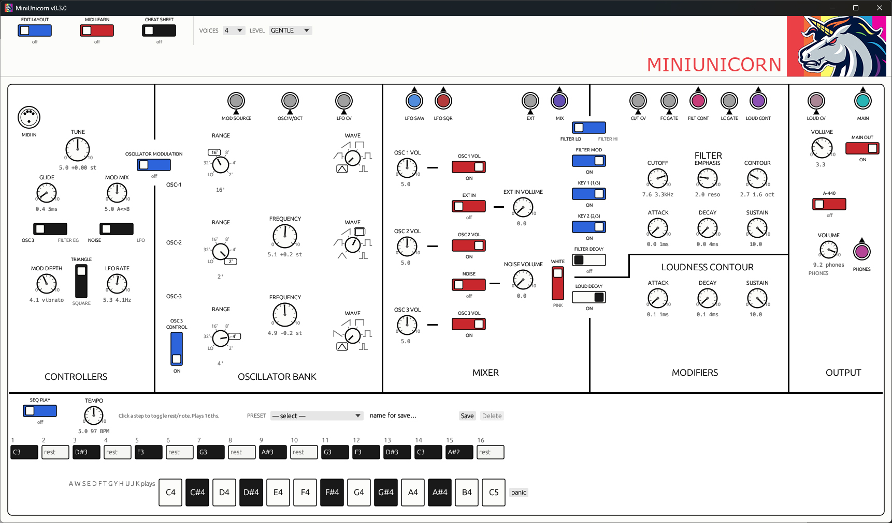

# MiniUnicorn




MiniUnicorn is a standalone Rust desktop synthesizer inspired by the **Moog
Minimoog Model D**. It is designed as a playable instrument and layout lab,
not as a claim of component-level hardware emulation.

## Features

- Standalone Windows application with a fixed Model D-inspired panel.
- Three oscillators with tuning, range, frequency, waveform, and modulation controls.
- Mixer for oscillator, external, noise, and feedback sources.
- Voltage-controlled ladder-style filter controls: cutoff, emphasis, contour, attack, decay, and sustain.
- Loudness contour with independent attack, decay, and sustain controls.
- Glide, modulation source/mix/depth, LFO rate, and square/triangle controls.
- On-screen keyboard, computer-keyboard playing, and 16-step sequencer.
- MIDI input with note, modulation-wheel, and pitch-bend support.
- CPAL audio-device selection and MIDI-device switching without restarting the application.
- Patch-bay jacks for modulation, oscillator control, filter, loudness, audio, phones, main output, and MIDI input.
- Context-sensitive patch routing menus with audio, CV, gate, and modulation compatibility filtering.
- External input routing, phones routing, main-output routing, and feedback behavior.
- Grid-snapped panel editor with dragging, box selection, multi-selection, rotation, hide/show, lines, labels, and keyboard nudging.
- Named layout save/load support in `%APPDATA%\\miniunicorn`.
- Preset save/load support.
- MiniUnicorn logo embedded in the Windows executable and application window icon.

## Patch Bay

The patch bay is a set of virtual jacks. Each jack is either an **output**
(a source signal) or an input (a destination). To make a connection, click an
input jack and choose a compatible output from its menu; the routing is stored
in the patch and applied inside the DSP on every sample.

The output "signals" are generated on demand inside the per-sample voice render,
not held in a buffer. Each output jack maps to a route code, and the DSP reads
that code wherever the signal is needed.

### Output jacks (signal sources)

| Output | Signal carried | How it is generated |
| --- | --- | --- |
| **LFO SAW** | LFO ramp, ±1 | LFO phase accumulator (triangle/saw wave) |
| **LFO SQR** | LFO square, ±1 | Sign of the LFO phase |
| **MIX** | Pre-filter mixer bus | OSC1 + OSC2 + OSC3 + noise + external/feedback |
| **FILT CONT** | Filter contour envelope, bipolar ±1 | Filter attack/decay/sustain envelope |
| **LOUD CONT** | Loudness contour envelope, 0..1 | Loudness attack/decay/sustain envelope |
| **PHONES** | Post-output bus × phones level, clamped ±1.2 | Main output tapped after the amplifier |
| **MAIN** | Final output sample, clamped ±1.2 | Output bus (also used as the feedback source) |

### Input jacks (destinations)

| Input | Accepts | Effect |
| --- | --- | --- |
| **MOD SOURCE** | LFO SAW, LFO SQR | Feeds the modulation bus |
| **OSC1 V/OCT** | FILT CONT, LOUD CONT | Shifts the oscillator bank by up to ±1 octave |
| **LFO CV** | FILT CONT, LOUD CONT | Modulates LFO rate |
| **CUT CV** | FILT CONT, LOUD CONT | Modulates filter cutoff (±2 octaves) |
| **LOUD CV** | FILT CONT, LOUD CONT | Modulates output level |
| **EXT** | MIX, PHONES, MAIN | Feeds the external/feedback mixer input |
| **FC GATE** | LFO SQR | Gates the filter contour |
| **LC GATE** | LFO SQR | Gates the loudness contour |

The **PHONES** output can additionally be patched to a number of inputs through
its own routing path, independent of the general patch-bay logic.

Routing is filtered by compatibility, so only sensible output/input pairs appear
in the menus (for example, audio outputs such as MIX, PHONES, and MAIN can only
reach the EXT input, while contour outputs drive the CV and V/OCT inputs).

## Instrument Comparison

| Instrument | Relationship | Approximate closeness |
| --- | --- | --- |
| **Moog Minimoog Model D** | Primary panel, signal-flow, control, and terminology reference. | **High at the control and workflow level.** The oscillator, mixer, filter, contour, glide, modulation, and keyboard concepts are intentionally Model D-like. It is not component- or calibration-accurate hardware emulation. |
| **Behringer Model D** | Modern analog hardware recreation of the same classic architecture. | **High in signal-flow concepts.** MiniUnicorn is software, adds digital routing and layout tools, and does not reproduce the behavior of its analog circuits. |
| **Arturia Mini V** | Commercial software instrument based on the Model D. | **Moderate in front-panel vocabulary and basic synthesis architecture.** MiniUnicorn is much more focused on the core panel and patch-bay experimentation, with fewer studio-production features. |
| **Native Instruments Monark** | Software instrument inspired by classic Moog monosynths. | **Moderate in subtractive-monosynth workflow.** MiniUnicorn shares the broad oscillator/filter/envelope model but does not attempt Monark's specific modeled sound or feature set. |

The closest description is: **a Model D-inspired software instrument with a
visual patch-bay and editable panel layout**.

## Download

Download the current Windows release from the
[Releases page](https://github.com/DefconUnicorn/MINIUNICORN-V3/releases).

The release contains `miniunicorn-v3.exe`.

## Build From Source

Install the Rust toolchain for Windows, then run:

```powershell
cargo build --release
```

The executable is written to:

```text
target/release/miniunicorn-v3.exe
```

The Windows icon is embedded during the build from `icon.ico` using `build.rs`.

## Audio and MIDI

MiniUnicorn uses `cpal` for audio output and `midir` for MIDI input. Select the
available devices from the relevant output and MIDI jack menus. Audio-device
availability depends on the Windows audio drivers installed on the machine.

## Project Status

This is an actively developed standalone instrument and experimental layout
environment. The UI and routing model are stable enough to play, but the DSP
should be treated as an approximation rather than a certified Model D clone.

## License

No license has been declared yet.
